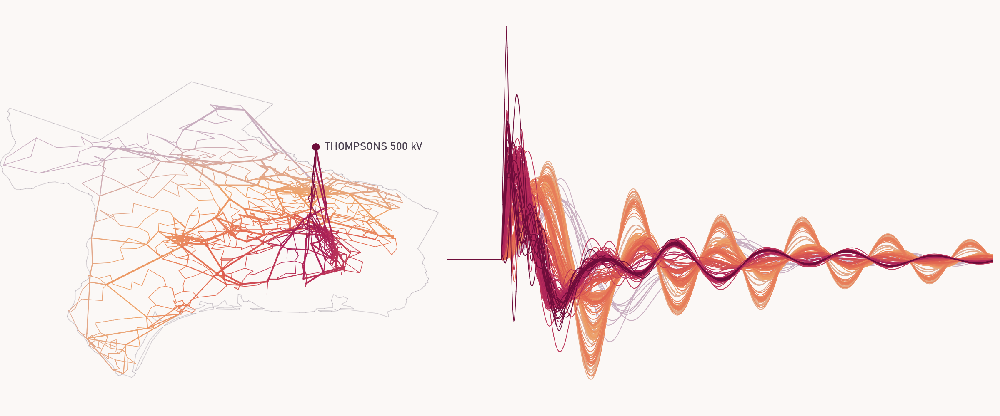

<p align="center">
  <picture>
    <source media="(prefers-color-scheme: dark)" srcset="docs/media/banner-dark.png">
    
  </picture>
</p>

# GridKit Web

[](https://github.com/lukelowry/gridkit-web/actions/workflows/check.yml)
[](https://github.com/ORNL/GridKit/tree/develop)
[](LICENSE)

Simulate [GridKit](https://github.com/ORNL/GridKit) power-system cases in the browser, with live plots and network
playback.

To run it locally:

```sh
docker compose up
```

Then open [gridkit.localhost:8080](http://gridkit.localhost:8080). Its library is the `library/` folder: add `.case.json`
files there.

## Remote simulation

To run studies on a solver elsewhere (this repo's `solver` service, given a token), set it in a `.env` beside
`compose.yaml`:

```sh
GRIDKIT_SOLVER_URL=https://solver.example.com
GRIDKIT_SOLVER_TOKEN=your-token
```

Then start everything but the local solver:

```sh
docker compose up ui library
```

## Author

[Luke Lowery](https://lukelowry.github.io/), PhD student in the
[Birchfield Research Group](https://birchfield.engr.tamu.edu/) at Texas A&M University ·
[Google Scholar](https://scholar.google.com/citations?user=CTynuRMAAAAJ&hl=en) ·
[ORCID](https://orcid.org/0009-0000-0029-3403)

Also by the author: [gridkit-studio](https://github.com/lukelowry/gridkit-studio), GridKit in VS Code ·
[latkit](https://latkit.readthedocs.io), GPU visualization of large networks.

## License

[BSD-3-Clause](LICENSE). The solver image also carries the licenses in `services/solver/licenses`.

Uses [GridKit](https://github.com/ORNL/GridKit) from Oak Ridge National Laboratory.
